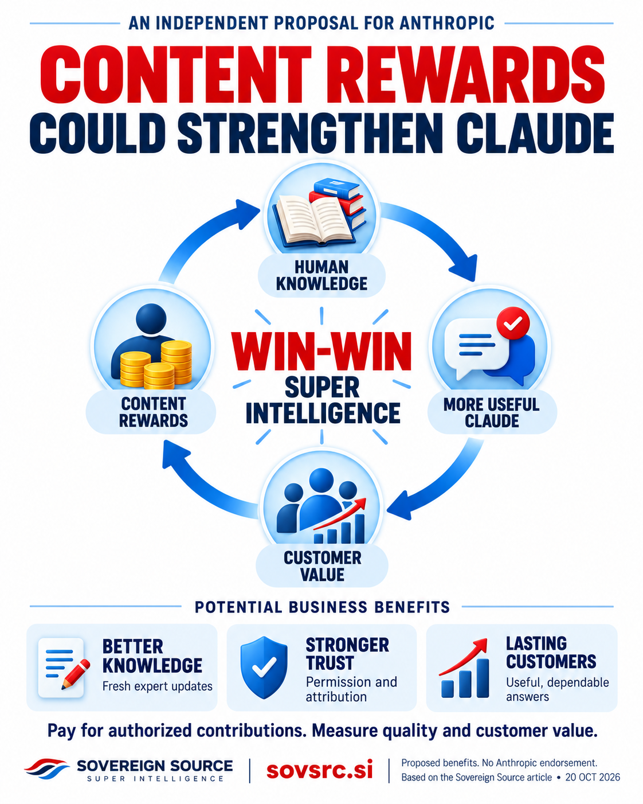

# Why Content Rewards Could Strengthen Anthropic and Claude

An independent public proposal from Sovereign Source · <time datetime="2026-10-20">20 October 2026</time>

<strong>Anthropic could build a stronger Claude business by rewarding the people who supply useful knowledge, improve its evidence and keep its sources current.</strong> Paying contributors adds a direct expense. It can also support a better product, more dependable access to expertise and relationships that help the business grow.

The commercial question is whether those benefits exceed the cost of payments and administration. For valuable specialist knowledge, that is a proposition worth testing.

Sovereign Source proposes that Anthropic develop a transparent content rewards program covering authorized training material, licensed sources consulted during answers, and accepted expert contributions. Authors, researchers, publishers, software maintainers and professional communities could participate under clear agreements. Recognition would acknowledge the contribution; financial rewards would compensate agreed work or uses.

<figure class="article-figure">
  
  <figcaption>A proposed cycle of shared value: human knowledge improves Claude, customer value supports rewards, and rewards help fund further contributions. <a href="../assets/infographics/anthropic-claude-content-rewards-circular.png">View the full-size infographic</a>.</figcaption>
</figure>

## A natural fit for Claude’s business model

Anthropic's own business model provides a natural foundation. In February 2026, the company reaffirmed its commitment to an ad-free Claude and described enterprise contracts and paid subscriptions as its revenue model. It emphasized preserving the assistant's ability to act in the user's interests. Content rewards could fit that approach by funding knowledge that makes the service useful. [Anthropic's explanation of Claude's business model](https://www.anthropic.com/news/claude-is-a-space-to-think).

The direction of payment matters. Anthropic would pay for authorized contributions. Contributors would not purchase favorable answers or preferential recommendations. Source selection should follow relevance and evidence, with financial relationships disclosed where appropriate. That separation would help preserve the trust on which a paid assistant depends.

Claude already connects to specialist information providers. Anthropic's May 2026 financial-services announcement describes governed access to sources including FactSet, Morningstar, LSEG and research providers. These integrations demonstrate the place of external knowledge in Claude's commercial offering. They do not, by themselves, establish how individual authors or analysts are compensated. [Anthropic's financial-services announcement](https://www.anthropic.com/news/finance-agents).

A broader rewards program could make participation practical for smaller suppliers as well. An independent researcher, a specialist publisher or a group maintaining technical documentation could offer material under understandable terms without needing to become a large data vendor.

## A more reliable supply of useful knowledge

The first potential benefit is a more reliable supply of useful knowledge. A document's acquisition price tells only part of its economic story. Finding relevant material, establishing permissions, checking accuracy, removing duplication and obtaining corrections all take work. A continuing relationship with a qualified contributor could reduce repeated effort across those activities.

Consider a specialist publisher that maintains engineering guides. Under an agreed arrangement, it could provide reviewed editions, identify obsolete instructions and supply corrections when new evidence emerges. Claude users would gain access to a maintained resource. The publisher would have a reason to keep improving it. Anthropic could spend less effort rediscovering which version is reliable.

That outcome depends on quality and demand. Paying for redundant documents would increase costs without improving Claude. The relevant measure is the total cost of obtaining and maintaining knowledge that helps customers, including contributor fees, verification and administration.

Different contributions need different payment arrangements:

Scroll across to compare contributions, payments and benefits.

  <table>
    <caption>Four ways to reward useful contributions</caption>
    <thead><tr>
      <th scope="col">Contribution</th>
      <th scope="col">Possible payment</th>
      <th scope="col">Potential benefit to Anthropic</th>
    </tr></thead>
    <tbody>
      <tr>
        <th scope="row">Authorized material accepted for model training</th>
        <td>Negotiated license fees or a defined training-contribution fund</td>
        <td>Planned access to useful material with documented permissions</td>
      </tr>
      <tr>
        <th scope="row">Licensed sources accessed while serving customers</th>
        <td>Agreed access fees or payments for qualifying use</td>
        <td>Current specialist knowledge that supports valuable services</td>
      </tr>
      <tr>
        <th scope="row">Reviewed corrections, evaluations and documentation updates</th>
        <td>Fees or bounties for accepted work</td>
        <td>Better coverage of mistakes, omissions and changing information</td>
      </tr>
      <tr>
        <th scope="row">New research and shared knowledge resources</th>
        <td>Grants or awards with published selection criteria</td>
        <td>Continued production of knowledge that future AI services can use</td>
      </tr>
    </tbody>
  </table>

## Evidence customers can inspect

The second benefit is a stronger product for customers who need evidence they can inspect. Claude's citation capability can point to passages in supplied documents, while its web-search tools can connect answers to external sources. Those features offer useful foundations for source records. A rewards service would still require separate agreements, rights verification and payment accounting. [Claude citation documentation](https://platform.claude.com/docs/en/build-with-claude/citations), [Anthropic's web-search announcement](https://claude.com/resources/articles/web-search-api).

A citation does not establish ownership, permission or a payment amount. Nor does it measure a document's exact causal contribution to the model's underlying knowledge. Training payments should therefore be based on agreed inclusion, delivery or licensing terms. Payments for source access should use defined, verifiable events. Contributors should be able to understand what earns a payment without relying on an AI-generated claim of influence.

Clear arrangements could also make customer evaluation easier. A business considering Claude for specialist work could inspect the available collections, their permitted uses and the process for correcting errors. That may support procurement and renewal where dependable information matters. These are commercial outcomes to measure, rather than savings to assume.

## Stronger relationships with contributors

The third benefit is a healthier relationship with the communities that create knowledge. Reliable payments and accurate credit give contributors tangible reasons to maintain their work and continue participating. A professional community that benefits from an assistant may also introduce it to members and customers. Such referrals should follow demonstrated usefulness, and any separate promotional payments should be disclosed.

Voluntary contributor syndicates could help small participants negotiate and administer these relationships. Their members should be able to see payment calculations, administration charges and how proceeds reach the people who did the work. Paying an intermediary does not necessarily compensate every underlying contributor.

Participation should preserve control. Contributors need separate choices about training, retrieval, evaluation and redistribution. Someone uploading an employer's document must have authority to offer it. Customer conversations and confidential materials should enter a shared contribution program only through appropriate, explicit authorization. Agreements should explain withdrawal for future uses and the treatment of previously authorized training.

Open contributions should retain their existing terms. Rewards could fund maintenance, documentation and expert review around an open resource. Public-domain knowledge should remain available. Documented influences could receive recognition and voluntarily agreed rewards without turning every shared idea into an automatic payment claim.

Anthropic already supports researchers through its AI for Science program, announced in May 2025 with API credits for selected projects. Content rewards could complement that support by paying for accepted contributions and the work of maintaining useful resources. Cash compensation should be payable independently of whether a contributor purchases Claude access. [Anthropic's AI for Science program](https://www.anthropic.com/news/ai-for-science-program).

## The economics need to work

Funding could come from negotiated licensing budgets, relevant enterprise services or a disclosed share of defined subscription or API revenue. Any revenue share would need clear rules about the revenue included, deductions and payment timing. Contractual earnings should be distinguishable from discretionary awards.

The economics must include the cost of delivering the service. A program succeeds commercially when improved customer value, retention and knowledge supply justify contributor payments alongside compute, staff and administration. It should not depend on contributors spending their earnings back on Claude.

A focused public pilot could test that proposition with an authorized specialist collection and ongoing expert updates. Useful measures would include answer quality, correction turnaround, contributor retention, customer renewals and the full cost of maintaining the collection. Paying simply for upload volume or repeated citations would invite manipulation; rewards should recognize accepted work or qualifying use under reviewable rules.

Anthropic's Economic Index already examines how AI changes work. A content rewards program could add another measurable dimension to that inquiry: whether the people supplying valuable knowledge share in the economic gains. Aggregate reporting could show who receives payments and how broadly participation extends while protecting private agreements and customer information. [The Anthropic Economic Index](https://www.anthropic.com/research/the-anthropic-economic-index).

## A cycle of shared value

The opportunity is a reinforcing relationship. Contributors produce and maintain useful knowledge. Claude helps customers apply it. Revenue supports both the service and further human contributions. If that relationship delivers measurable value, Anthropic gains a stronger supply base, a more useful product and more reasons for customers to stay.

For Sovereign Source, this is the ambition of win-win superintelligence: greater machine capability should expand people's opportunities to discover, create and earn. Anthropic could make that ambition concrete by treating contributor rewards as an investment in Claude's future.

Sovereign Source is a research initiative exploring permission, attribution and contributor rewards. This proposal is independent of Anthropic and does not announce an Anthropic program, partnership or operating Sovereign Source payment service. Read the <a href="PUBLIC_OVERVIEW.html">project principles</a> and the <a href="CONTENT_REWARDS_AI_SUSTAINABILITY_ARTICLE.html">business case for contributor rewards</a> at <a href="https://sovsrc.si">sovsrc.si</a>.

