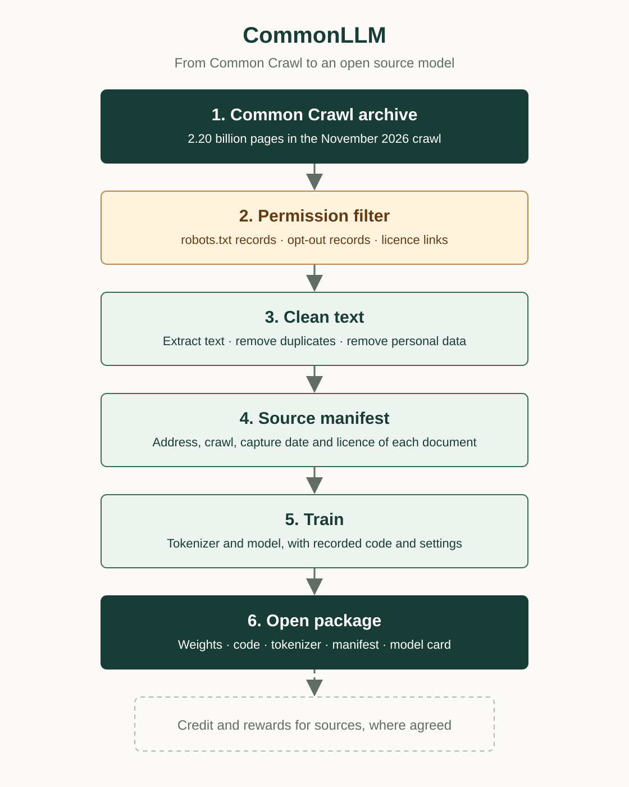

# CommonLLM: Common Crawl as an LLM for Open Source AI and SI

*A proposal from Sovereign Source — 25 November 2026*

**CommonLLM is a proposal to make one open source LLM from Common Crawl.** The project processes the crawl into a documented corpus, trains a model from it, and publishes all parts. The planned home of the project is [commonllm.org](https://commonllm.org).

This article describes a plan. No CommonLLM model exists today. CommonLLM is not affiliated with the Common Crawl Foundation.

## What Common Crawl is

Common Crawl is a nonprofit organization that collects web pages and publishes them at no cost. It has collected web data since 2008. [Common Crawl overview](https://commoncrawl.org/overview) · [Common Crawl questions and answers](https://commoncrawl.org/faq).

The November 2026 crawl has 2.20 billion pages from 34.2 million registered domains. Its content is 382.14 TiB before compression. Each crawl has three file types: WARC for the full responses, WAT for metadata and links, and WET for plain text. [November 2026 crawl announcement](https://commoncrawl.org/blog/november-2026-crawl-archive-now-available).

Common Crawl is already a base of commercial AI. A Mozilla Foundation study examined 47 text LLMs published from 2019 to October 2023. At least 64% of them used filtered versions of Common Crawl. [Training Data for the Price of a Sandwich](https://www.mozillafoundation.org/en/research/library/generative-ai-training-data/common-crawl/).

## The problem that CommonLLM answers

Each AI company filters Common Crawl in private. The public cannot see which pages a company kept, which pages it removed, or why. The same work is done many times, and each result is closed.

CommonLLM proposes to do this work one time, in public. The crawl is the raw material. The model, with its records, is the packaged result. A small company, a university or a public body can then start from the same base as a large laboratory.

## How to process Common Crawl into a model

*The proposed sequence, not a completed system. [Download PNG](../assets/diagrams/commonllm-common-crawl-pipeline.png) · [View SVG](../assets/diagrams/commonllm-common-crawl-pipeline.svg).*

1. **Select the crawls.** Record each crawl identifier, for example `CC-MAIN-2026-47`.
2. **Read the permission signals.** Each crawl includes the robots.txt records that the crawler fetched. Read those records, the opt-out records and the licence links in each page.
3. **Extract the text.** Use the WET files, or extract text from the WARC files with published code. Identify the language of each document.
4. **Clean the text.** Remove duplicates, low-quality pages and personal data. Publish each rule.
5. **Write a source manifest.** For each document, record the address, the crawl, the capture date, the file position, the licence signal and a content hash.
6. **Train the tokenizer and the model.** Record the code revision, the configuration and the random seed.
7. **Test the model.** Publish the tests and the results, including the failures.
8. **Publish the package.** Release the weights, the code, the tokenizer, the manifest and a model card.

The method to find licences already exists. Creative Commons used Common Crawl data each month to find pages with links to its licences. [Creative Commons catalog data process](https://opensource.creativecommons.org/blog/entries/cc-datacatalog-data-processing/).

## What makes the result open source

The Open Source AI Definition 1.0 names three parts of an open source AI system. CommonLLM publishes each part. [Open Source AI Definition 1.0](https://opensource.org/ai/open-source-ai-definition).

| Part | Requirement in the definition | CommonLLM release |
| --- | --- | --- |
| Data information | Enough detail for a skilled person to build an equivalent system | The source manifest, the filter rules and the crawl identifiers |
| Code | The complete source code to train and operate the system | The filter code, the training code and the test code |
| Parameters | The model weights and settings | The weights, the tokenizer and the configuration |

Common Crawl makes the data information practical. Each page already has a public address, a capture date and a fixed position in a public file. A person can thus build the corpus again and compare the result.

## Permission is the difficult part

Free access to a page is not permission to use it for all purposes. The Common Crawl terms give a limited licence and tell users to respect the copyrights of third parties. The terms also make the user responsible for claims from the use of crawled content to train AI systems. [Common Crawl terms of use](https://commoncrawl.org/terms-of-use).

The law for model training on web pages is different in each country, and courts have not settled all questions. CommonLLM thus separates the corpus into groups:

- **Open group.** Public domain text and text with a licence that permits commercial use and changes. The first model uses only this group.
- **Agreed group.** Text from owners who give permission for training, with terms that the owner accepts.
- **Excluded group.** Text with an opt-out signal, a licence that prohibits the use, or no clear signal.

There is evidence that the open group is sufficient for a useful model. The Common Pile project collected eight terabytes of public domain and openly licensed text from 30 sources. Its two models have 7 billion parameters each. The authors report performance that is competitive with Llama 1 and Llama 2 models of the same size. [The Common Pile v0.1](https://arxiv.org/abs/2506.05209).

A licence link in a page can be wrong. The manifest lets any person check a source and report an error. The project then removes the source from the next release.

## Attribution and contributor rewards

The manifest gives each source an identity. This makes credit possible for licences that require attribution. It also gives site owners a method to find their pages in the corpus.

Rewards need an agreement. A manifest shows which documents the training consumed. It does not measure the share of each source in each answer. Sovereign Source proposes that the agreed group pays its contributors by the terms that they accepted. [Project principles](PUBLIC_OVERVIEW.md).

## Why this supports commercial open source AI

A company can use a CommonLLM model, adapt it and sell services on it. The licence of the weights will permit commercial use. The licence choice is open; the project will select a licence that open source bodies recognize.

The benefit is a common base that all people can examine. A buyer can ask which sources a model used, and the supplier can answer from the manifest. A regulator, an auditor or a competitor can do the same check. This is the practical meaning of democratized AI: the base layer is open to inspection and to use.

A larger model can also be a teacher for a CommonLLM model. That method adds a dependency on the teacher and its training data. See [Building a Competing AI Model with Nemotron 3 Ultra](NEMOTRON_COMPETING_MODEL_ARTICLE.md).

## Limits

- **Size.** One crawl has 87.78 TiB of compressed WARC files and 6.03 TiB of WET files. The process needs rented compute and time. The training cost is larger than the filter cost.
- **Quality.** Web text has errors, bias and repeated content. Filters decrease these problems but do not remove them.
- **Capability.** A model from the open group will not equal the largest closed models. Its value is that people can examine it and build on it.
- **Language.** English pages are the largest part of the crawl. Other languages need separate work.
- **SI.** A common base does not make superintelligence (SI). It lets more people examine and improve the base of systems that become more capable.

## Next steps

1. Publish the manifest format at [commonllm.org](https://commonllm.org).
2. Publish the filter code and the manifest for one crawl.
3. Train a small model from the open group and publish the full package.
4. Start a procedure for site owners to add or remove their sites.

*This is general analysis of the cited sources and terms, not a legal opinion for a particular use. Sovereign Source remains a research initiative.*

*Related reading: [Sovereign Source principles](PUBLIC_OVERVIEW.md), [Building a Competing AI Model with Nemotron 3 Ultra](NEMOTRON_COMPETING_MODEL_ARTICLE.md), and [Superintelligence Should Be a Win for Humans and Machines](SUPERINTELLIGENCE_SHARED_PROSPERITY_ARTICLE.md).*
