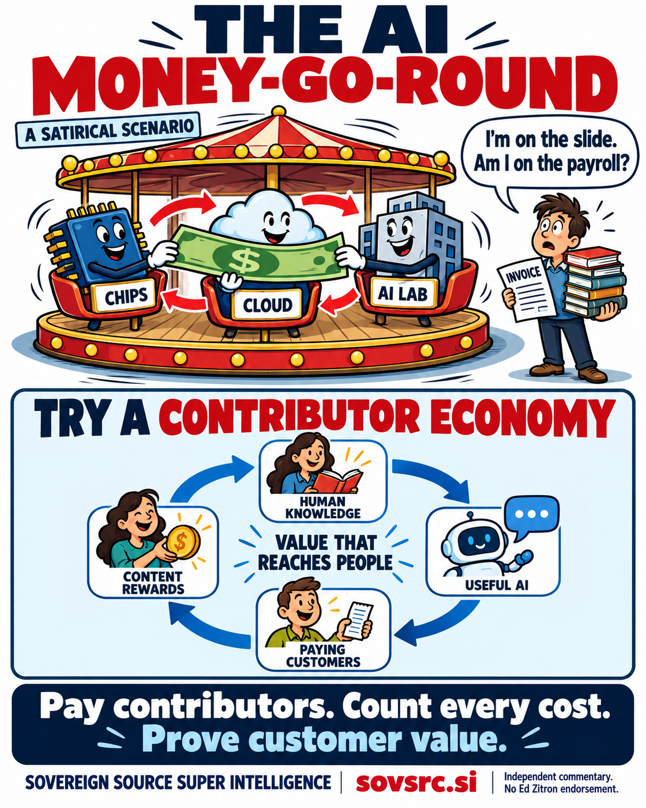

# What Ed Zitron’s AI Criticism Means for Content Rewards

Independent commentary from Sovereign Source · <time datetime="2026-10-20">20 October 2026</time>

<strong>Ed Zitron’s criticism of the AI industry offers a useful test for content rewards: show who benefits, show who pays, and count the whole bill.</strong> Paying people for valuable knowledge could help sustain better AI services. It also creates a cost that a credible business must be able to support.

A circle is easy to draw on a pitch deck. Getting money to the person who wrote the useful material is harder. The researcher outside the AI money-go-round is entitled to wonder whether appearing in the presentation comes with an actual payment.

Sovereign Source’s proposal is to connect authorized human contributions, useful AI services, customer value and agreed rewards. Zitron’s writing is a reason to make that proposal more demanding about evidence. A cheerful diagram cannot establish that the economics work.

<figure class="article-figure">
  
  <figcaption>An original satirical illustration of a funding loop and a proposed contributor economy. The cartoon is a metaphor, not a record of specific transactions or a quotation from Ed Zitron. <a href="../assets/infographics/ed-zitron-content-rewards-money-go-round.png">View the full-size infographic</a>.</figcaption>
</figure>

## Three criticisms worth taking seriously

In <a href="https://www.wheresyoured.at/what-were-fighting-for/">What We’re Fighting For</a>, published in February 2025, Zitron argues that pressure for continual growth can push technology companies to make products more extractive and less useful. His criticism concerns the incentives governing technology and the experience of people using it. That is a relevant challenge for any platform promising to share value.

In <a href="https://www.wheresyoured.at/ais-economics-dont-make-sense/">AI’s Economics Don’t Make Sense</a>, published in April 2026, he focuses on the mismatch between subscription prices and the variable cost of running AI workloads. He argues that subsidized use can obscure what customers would accept at more realistic prices. For content rewards, the implication is straightforward: a payment promise needs a dependable source of funding.

In <a href="https://www.wheresyoured.at/ai-doesnt-have-roi/">AI Doesn’t Have ROI</a>, published in June 2026, Zitron challenges claims of economic benefit that do not adequately account for unreliable outputs, spending and the work needed to supervise systems. His broad conclusion is his argument, rather than a finding established for every AI application. The practical question for a rewards program is whether customers receive something measurably useful after those costs are included.

There is a concrete industry example behind the cost debate. GitHub’s April 2026 Copilot billing announcement acknowledged escalating inference costs and described its premium-request model as unsustainable. It announced a transition toward billing based on token usage. That supports scrutiny of delivery costs; it does not establish the finances of every AI business. [GitHub’s billing announcement](https://github.blog/news-insights/company-news/github-copilot-is-moving-to-usage-based-billing/).

## A better circle still needs real demand

Investment, infrastructure spending and sales serve different economic purposes. A company receiving investment and spending it with a supplier creates business for that supplier. The transaction alone does not show that end customers receive enough value to sustain the whole chain.

A contributor economy faces the same test. Adding a payment to an author does not erase computing costs, create demand for an unwanted service or turn an inaccurate answer into a useful one. Content rewards need to sit inside a service that people have a reason to use and fund.

That is the distinction between drawing a circle and building a sustainable relationship. A customer pays for help with a real task. The service covers its costs. Contributors receive the compensation agreed for their material or work. Their continued participation may improve the service. Each connection needs evidence.

The money-go-round can have excellent music and still need someone to buy a ticket.

## Reward the work that makes answers useful

The strongest case for rewards starts with a specific contribution. An expert maintains an explanation, catches an error, documents an exception or supplies an authorized source that was difficult to obtain. The service can then test whether that contribution improves what customers receive.

Consider a community maintaining technical documentation. A pile of old pages may contain several contradictory instructions. The maintainers know which version applies, what changed and which warning deserves attention. Paying for reviewed updates could help an AI service use more dependable material and reduce repeated investigation. Whether it does so depends on implementation and measurement.

The proposed reward should match the contribution:

Scroll across to compare contributions, rewards and outcomes.

  <table>
    <caption>What a contributor reward should be able to explain</caption>
    <thead><tr>
      <th scope="col">Contribution</th>
      <th scope="col">Possible reward</th>
      <th scope="col">Outcome to test</th>
    </tr></thead>
    <tbody>
      <tr>
        <th scope="row">Authorized specialist material</th>
        <td>Agreed licensing or access fees</td>
        <td>More useful coverage with documented permissions</td>
      </tr>
      <tr>
        <th scope="row">Reviewed updates and corrections</th>
        <td>Fees for accepted work</td>
        <td>Fewer outdated answers and faster correction</td>
      </tr>
      <tr>
        <th scope="row">Expert evaluations and explanations</th>
        <td>Payment for defined review tasks</td>
        <td>Better detection and understanding of errors</td>
      </tr>
      <tr>
        <th scope="row">Maintenance of open knowledge</th>
        <td>Grants or awards with clear criteria</td>
        <td>Continuing public access and dependable updates</td>
      </tr>
    </tbody>
  </table>

A reward scheme that pays for sheer upload volume risks purchasing a mountain of duplicates. A scheme that pays for every citation risks turning footnotes into a competitive sport. Accepted contributions and defined, verifiable uses are more credible starting points.

## Keep permission and the commons intact

Public availability, attribution and permission for a particular use are different matters. A rewards agreement should explain what a contributor is authorized to offer and whether the agreement covers training, retrieval, evaluation or redistribution. A citation should help a reader find the source; it should not be treated as proof that every permission or payment question is settled.

Recognition can also extend to documented influences and community contributions. Those connections can support voluntarily agreed sharing without turning every idea into a privately owned toll road. Public-domain information should remain available, and open resources should retain their existing licenses.

Voluntary syndicates could help contributors negotiate and administer these arrangements. Members would need understandable payment statements, visible administration charges and a way to question decisions. A reward paid to an intermediary should not be presented as money received by every person whose work helped create the collection.

The point is to make participation worth considering on clear terms. A dashboard full of congratulatory badges has limited usefulness at the supermarket.

## Measure the particular use rather than the whole dream

Evidence can support specific benefits without validating an entire industry’s promises. In a 2025 study of 5,172 customer-support agents, Erik Brynjolfsson, Danielle Li and Lindsey Raymond found that access to an AI assistant increased issues resolved per hour by 15% on average. Effects varied substantially across workers, and the study concerned a particular deployment. It did not test a content rewards program or establish the net profitability of frontier labs. [Generative AI at Work, The Quarterly Journal of Economics](https://academic.oup.com/qje/article/140/2/889/7990658).

The researchers also raise a relevant long-term question: if skilled workers contribute fewer original solutions, later systems may have less useful material for handling new problems. That is a reason to investigate how human expertise is sustained, rather than assuming the supply will renew itself. It is not evidence that a particular payment scheme will succeed.

A content rewards pilot should therefore examine answer quality, correction effort, contributor retention and customer willingness to continue paying. Its cost assessment should include computing, appropriate infrastructure costs, human review, contributor payments and administration. A faster answer that requires expensive checking may offer less value than its speed suggests.

Rewards can be justified as a deliberate investment in a public resource or as a commercial expense. The funding basis should be explicit. A grant-supported project need not pretend that every payment already comes from profitable subscriptions.

## Let the value reach people

Contributor payments should be usable outside the platform. If someone earns cash, buying more AI credits should be their choice. A business that requires recipients to spend their entire reward back on its own service has not demonstrated independent customer demand through that transaction.

Reliable payments, accurate credit and useful participation could build goodwill. They could also encourage fresh contributions and referrals. Those are plausible benefits to evaluate, not a substitute for measuring results or a guarantee that higher payouts will improve margins.

Sovereign Source’s response to Zitron’s criticism is to take the test seriously. Content rewards should make the people behind useful knowledge visible in the economics, while keeping customer value and total costs equally visible. A program that cannot explain those relationships needs improvement, however attractive its diagram.

Pay the people who keep knowledge useful. Show the costs. Show the results. Give the contributor enough freedom to buy groceries instead of another lap around the server rack.

Sovereign Source is a research initiative exploring permission, attribution and contributor rewards. This article is an independent response to Ed Zitron’s published commentary; it does not imply his endorsement, participation or agreement. The infographic’s characters and dialogue are original satire. The contributor model is a proposal, not an operating Sovereign Source payment service. Read the <a href="PUBLIC_OVERVIEW.html">project principles</a>, the <a href="OPENAI_CHATGPT_CONTENT_REWARDS_ARTICLE.html">ChatGPT content rewards proposal</a> and the <a href="ANTHROPIC_CLAUDE_CONTENT_REWARDS_ARTICLE.html">Claude content rewards proposal</a> at <a href="https://sovsrc.si">sovsrc.si</a>.

