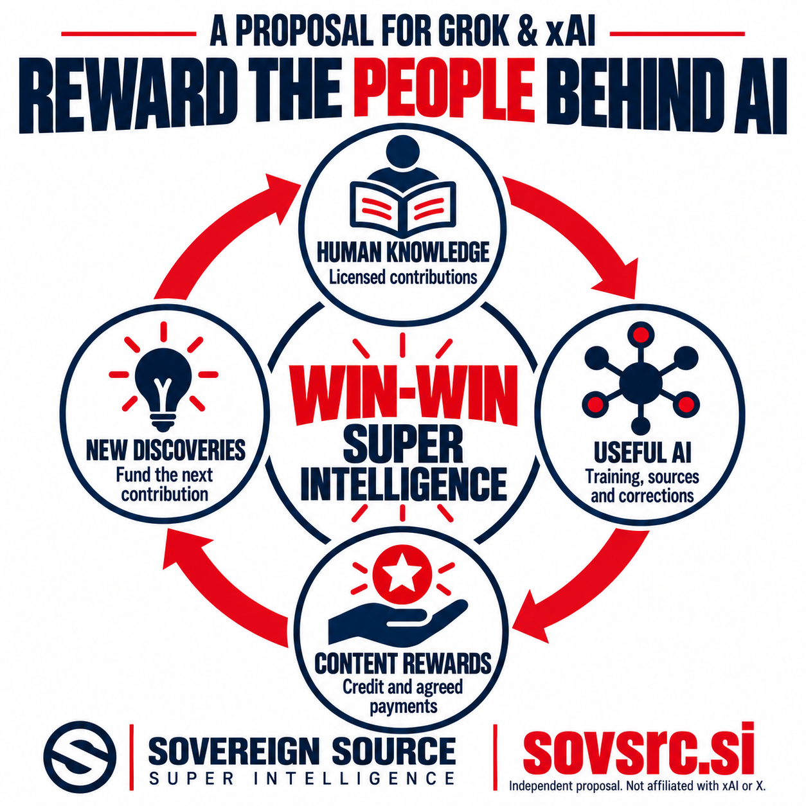

# A Proposal for Grok and xAI to Reward Human Knowledge

*An independent public proposal from Sovereign Source — 20 October 2026*

**Grok should help fund the people whose knowledge makes it useful.** Scientists, journalists, programmers, teachers and specialist communities produce the explanations, evidence and discoveries on which useful AI depends. When an AI business benefits from agreed uses of their work, those contributors should have a practical way to receive recognition and compensation.

Sovereign Source proposes that xAI and X establish **Grok Content Awards**: a voluntary program combining contributor recognition with financial rewards for authorized, documented contributions to large language models and the services built around them. The opportunity is to connect the economics of AI with the continued production of human knowledge.

*The proposed content rewards flywheel: agreed payments can help fund new discoveries and the next human contribution.*

X already provides a starting point. Its Original Content Rewards program pays eligible creators based on qualified impressions of original content. X describes originality in terms that include expertise, perspective and creativity, and its earlier Creator Revenue Sharing program ended in September 2026. That provides a precedent for paying people whose contributions make a platform valuable. [X Original Content Rewards](https://help.x.com/en/using-x/original-content-rewards).

There is also a separate, invitation-only Grok Bot Template Rewards pilot. X considers use and continued use of participants' templates when deciding discretionary payments. Those payments are neither guaranteed income nor a revenue share. The pilot shows that rewards can extend beyond attention in a social feed to something people find useful through an AI product. [Grok Bot Template Rewards Pilot](https://help.x.com/en/using-x/grok-bot-template-rewards-pilot).

Grok Content Awards would extend this principle to the knowledge behind the service: the paper that explains a mathematical method, the reporting that establishes a fact, the documentation that solves an engineering problem, or the expert correction that prevents the same mistake from recurring.

Consider a researcher who publishes a clear explanation of a new technique. People may read it on X, encounter it through a search, or benefit when a licensed version helps improve an AI model. Those are different uses. A credible awards program would give each use an intelligible agreement and payment basis.

The proposed program could support four complementary arrangements:

| Contribution | Proposed reward | Basis for the payment |
| --- | --- | --- |
| Authorized material accepted for model training | A license fee or participation in a defined training fund | An agreement identifying the material, permitted uses and accepted delivery or inclusion |
| Licensed sources accessed while answering questions | A usage payment or share of a defined revenue pool | Verified qualifying access or use under published rules |
| Expert corrections, evaluations and updates | Fees or bounties for accepted work | Review against agreed quality and acceptance criteria |
| Exceptional contributions to shared knowledge | Public recognition and funded awards | Disclosed criteria, independent review and conflict-of-interest controls |

Separating these arrangements matters. A scientist should not need a large social following to supply valuable expertise. A specialist guide may serve a small audience and still solve an expensive problem. Training payments should not depend on a promise to identify the exact contribution of one document to every future answer.

For sources consulted during an answer, Grok already has useful building blocks. Its X Search tool can retrieve posts and threads. Its citation system distinguishes sources encountered during research from links placed in an answer. These capabilities could support a rewards service, but they would need additional rights records, payment rules and verification. [Grok X Search documentation](https://docs.x.ai/developers/tools/x-search), [Grok citation documentation](https://docs.x.ai/developers/tools/citations).

That distinction is essential: a source appearing in a search record does not establish that it materially supported the answer. A citation alone does not establish ownership, permission or an amount owed. The program should define whether it pays for authorized access, verified use, accepted training material or another agreed event. Contributors should be able to understand the difference.

The same care should apply to influence. A new explanation may build on several earlier contributions. Where those relationships are documented, participants could agree to share rewards with upstream contributors. An AI-generated acknowledgment should never be the sole evidence for allocating money. Disputed claims need review, and independent discovery should remain possible without an automatic obligation to pay someone who expressed a similar idea.

Voluntary contributor syndicates could make participation practical for smaller groups. A research community, specialist publication or professional association could negotiate common terms and administer payments. Members should receive individual credit where appropriate, see how earnings are divided, understand any administration charges and have a meaningful way to challenge decisions.

Participation should offer clear choices about training, search access, evaluation and redistribution. Contributors should have authority to supply what they submit, including any necessary employer or coauthor permissions. Agreements should explain what withdrawal changes for future uses and what happens to previously authorized training. The program should avoid promising that removing a document will immediately erase its influence from an already trained model.

Payments should also preserve useful knowledge outside the marketplace. Public-domain material and open contributions should remain available on their existing terms. People could still be rewarded for maintaining a collection, checking evidence or producing a better explanation. Sovereign Source's broader recognition of ideas and influences is a proposal for cooperation, rather than a claim that every fact should have a private owner.

For xAI, the economic case deserves a serious test. Paying contributors raises direct costs, but a reliable relationship may reduce the effort required to locate useful material, establish permissions, obtain corrections and keep specialist knowledge current. The relevant measure is the total cost of useful knowledge, including payments, review and administration.

A contributor who sees accurate credit, understandable statements and reliable payments may also have a reason to recommend the service. That could strengthen goodwill and attract customers who value dependable sources. These are outcomes to measure through contributor retention, answer quality and customer demand. An awards announcement alone will not produce them.

Funding should be explicit. Grok could dedicate a disclosed portion of relevant subscription, API or enterprise revenue to agreed rewards, alongside negotiated licensing budgets and funded awards. The revenue definition, deductions and payout schedule should be understandable before contributors participate. Earned contractual payments should be distinguishable from discretionary prizes.

Quality must remain central. Paying by upload volume, repeated citations or manufactured traffic would invite spam and duplication. The program should reject fraudulent activity, review disputed ownership and assess whether contributions improve the service. Payment relationships should be disclosed where relevant, while the evidence supporting an answer should determine its conclusions.

A practical public pilot could invite independent researchers, specialist publishers and technical communities to offer authorized collections and expert updates. It could begin with documented source access and accepted contributions, publish its terms before enrollment, and report aggregate results on quality, contributor payments and administration costs. Expansion should follow evidence that the arrangement benefits contributors, users and the operator.

The invitation to the Grok and xAI teams is straightforward: make contributor rewards part of how AI earns trust and sustains its supply of knowledge. Give people a way to participate, understand the agreement, receive appropriate credit and share in the value of authorized uses.

Sovereign Source calls this a win-win ambition for superintelligence. More capable machines should expand people's ability to discover and create, while helping support the work that makes further progress possible. Grok has an opportunity to make that relationship visible in both its answers and its economics.

*Sovereign Source is a research initiative exploring permission, attribution and contributor rewards. This proposal is independent of xAI and X and does not announce an agreement or an operating Sovereign Source payment service. Explore the [project principles](PUBLIC_OVERVIEW.md) at [sovsrc.si](https://sovsrc.si).*
