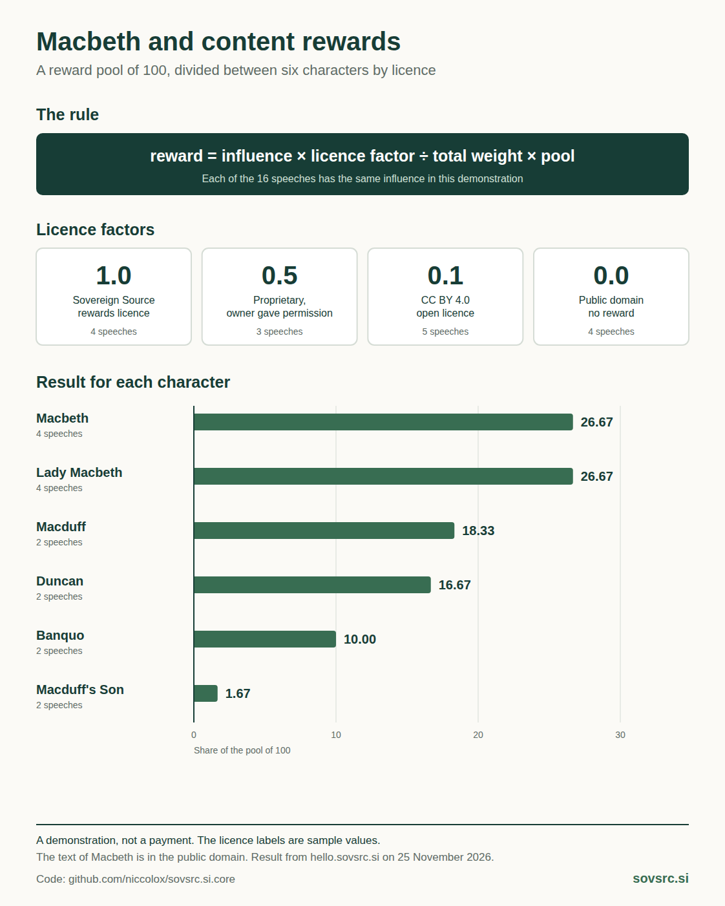

# Macbeth and Content Rewards: The Source Code

*Public analysis for Sovereign Source — 25 November 2026*

**Sovereign Source has one small program that calculates content rewards.** It uses 16 speeches from Macbeth as sample content. This article shows what the program does and where each part of its source code is.

The program is a demonstration. It is not a language model, and it makes no payment. No model is trained on the text of Macbeth.

<figure class="article-figure" style="max-width: 32rem; margin: 2.5rem auto 3rem;">
  
  <figcaption>The result of the demonstration on 25 November 2026. <a href="../assets/infographics/macbeth-content-rewards-leaderboard.png">View the full-size chart</a>.</figcaption>
</figure>

## Where the source code is

The code is in one public repository: [github.com/niccolox/sovsrc.si.core](https://github.com/niccolox/sovsrc.si.core). The links below point to one fixed version of each file.

| File | Content |
| --- | --- |
| [`macbeth.json`](https://github.com/niccolox/sovsrc.si.core/blob/38914fb05af6f6bfefa96b4ad5404995af215b6e/macbeth.json) | The sample data: six characters and 16 speeches, each with a licence label |
| [`hello_rewards.py`](https://github.com/niccolox/sovsrc.si.core/blob/38914fb05af6f6bfefa96b4ad5404995af215b6e/hello_rewards.py) | The data models and the reward calculation |
| [`server.py`](https://github.com/niccolox/sovsrc.si.core/blob/38914fb05af6f6bfefa96b4ad5404995af215b6e/server.py) | The web service, the Macbeth data load and the leaderboard |
| [`unified_hello.py`](https://github.com/niccolox/sovsrc.si.core/blob/38914fb05af6f6bfefa96b4ad5404995af215b6e/unified_hello.py) | A small training loop that records which samples each step used |
| [`rewards_mcp.py`](https://github.com/niccolox/sovsrc.si.core/blob/38914fb05af6f6bfefa96b4ad5404995af215b6e/rewards_mcp.py) | The same functions as tools for AI assistants |

The four Python files have about 1,300 lines in total.

The repository is public, so all people can read the code. It has no licence file at this time. It is thus not open source until we add a licence.

## The sample data

Each speech in `macbeth.json` has one line of text, its act and scene, and a licence label. For example, the first speech is "Your children shall be kings", from Act I, Scene 3.

The licence labels are sample values. They let the program show four different cases. The text of Macbeth is in the public domain, and no person owns these lines.

In the program, each character is a contributor. This lets one small file show six contributors with different licences.

## The reward rule

The rule is in the function [`calculate_rewards`](https://github.com/niccolox/sovsrc.si.core/blob/38914fb05af6f6bfefa96b4ad5404995af215b6e/hello_rewards.py#L88). It does these steps:

1. Read each citation of a model output. A citation names one content unit and gives an influence score from 0 to 1.
2. Find the licence factor of that content unit.
3. Ignore the citation if the factor is 0.
4. Calculate the weight: influence score × licence factor.
5. Divide the reward pool between the citations in proportion to their weights.

The licence factors are in [one small table in the code](https://github.com/niccolox/sovsrc.si.core/blob/38914fb05af6f6bfefa96b4ad5404995af215b6e/hello_rewards.py#L73-L78):

| Licence label | Factor | Meaning in the demonstration |
| --- | --- | --- |
| `sovsrc-rewards-v1` | 1.0 | The contributor joined a rewards agreement |
| `proprietary-opt-in` | 0.5 | The owner of proprietary text gave permission |
| `cc-by-4.0` | 0.1 | An open licence that requires credit |
| `public-domain` | 0.0 | No owner, so no reward |

These factors are sample values. A real agreement between contributors sets the real values.

## The Macbeth result

The function [`leaderboard_macbeth`](https://github.com/niccolox/sovsrc.si.core/blob/38914fb05af6f6bfefa96b4ad5404995af215b6e/server.py#L298) gives each of the 16 speeches the same influence. It then divides a pool of 100.

| Character | Speeches | Share of the pool |
| --- | --- | --- |
| Macbeth | 4 | 26.67 |
| Lady Macbeth | 4 | 26.67 |
| Macduff | 2 | 18.33 |
| Duncan | 2 | 16.67 |
| Banquo | 2 | 10.00 |
| Macduff's Son | 2 | 1.67 |

You can check the result by hand. The 16 speeches have four labels with factor 1.0, three with 0.5, five with 0.1 and four with 0.0. The total weight is 4.0 + 1.5 + 0.5 = 6.0. One speech with factor 1.0 thus gets 100 ÷ 6.0 = 16.67.

Duncan has two speeches: one with factor 1.0 and one in the public domain. His share is 16.67 + 0 = 16.67. Macduff's Son has one public domain speech and one CC BY speech. His share is 0 + 1.67 = 1.67.

The result shows the purpose of the rule. Two characters with the same number of speeches get different shares, because their licences are different.

## How to use it

The service is live. The first request after a period with no use can fail, because the service needs about one minute to start. Send the request again.

- **Leaderboard page:** [hello.sovsrc.si/ui/leaderboard](https://hello.sovsrc.si/ui/leaderboard)
- **Leaderboard data:** [hello.sovsrc.si/leaderboard/macbeth](https://hello.sovsrc.si/leaderboard/macbeth)
- **All pages:** [hello.sovsrc.si/ui](https://hello.sovsrc.si/ui)

To run the reward rule on your computer, get the repository and do these steps:

```sh
pip install pydantic
python hello_rewards.py
```

This prints a small example with two contributors. With a pool of 100, the first contributor gets 93.75 and the second gets 6.25. The Macbeth result comes from the web service in `server.py`.

## What the program does not do

- **It does not measure influence.** The influence score is an input. The program does not find which text caused an answer.
- **It does not store its records.** The records are in memory and are lost when the service stops.
- **It does not train a language model.** The training demonstration uses one small layer and random numbers.
- **It does not make payments.** The amounts are numbers in a calculation.
- **It has no automated tests.** The test command runs the example and prints the result.

## Next steps

1. Add a licence file to the repository.
2. Store the records in a database.
3. Train a small language model on a public domain text, and record which text each training step used.

*This is a description of a demonstration, not an operating payment service. Sovereign Source remains a research initiative.*

*Related reading: [Nemotron 3 Ultra, OpenWALDO, Sovereign Source SI and CommonLLM Side by Side](NEMOTRON_OPENWALDO_SOVEREIGN_SOURCE_COMMONLLM_COMPARISON_ARTICLE.md), [CommonLLM proposal](COMMONLLM_COMMON_CRAWL_OPEN_SOURCE_LLM_ARTICLE.md), and [Sovereign Source principles](PUBLIC_OVERVIEW.md).*

*New to these ideas? Start with [Win-Win Super Intelligence: A Plain Guide](WIN_WIN_SUPER_INTELLIGENCE_PLAIN_GUIDE_ARTICLE.md). It explains the project in plain words and links to each article.*
