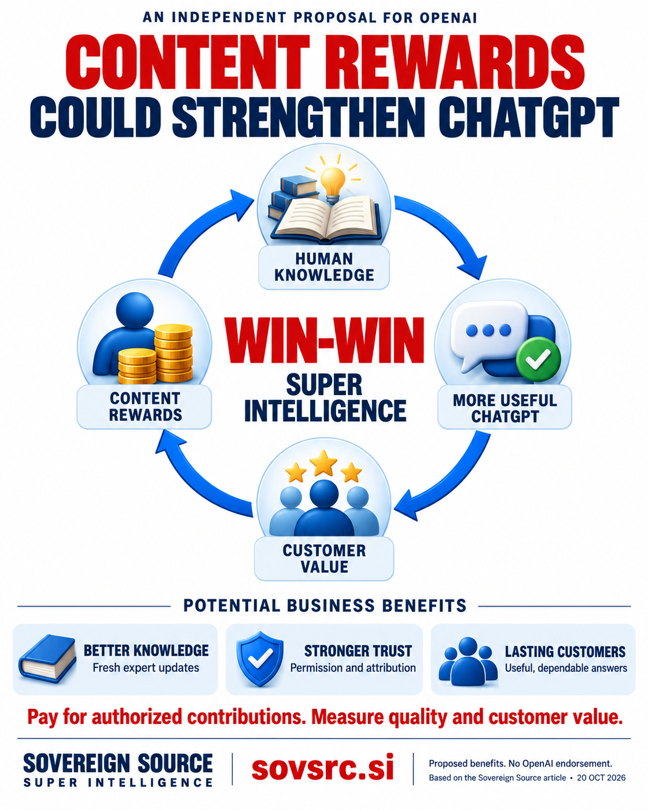

# Why Content Rewards Could Strengthen OpenAI and ChatGPT

An independent public proposal from Sovereign Source · <time datetime="2026-10-20">20 October 2026</time>

<strong>OpenAI could strengthen ChatGPT by making the people who create useful knowledge participants in its economic success.</strong> Content rewards could help sustain original research, specialist publications, maintained software documentation and expert corrections. For OpenAI, the potential return is better knowledge, stronger trust and more reasons for customers to stay.

Paying contributors creates an expense. The business case depends on whether better information and continuing relationships improve the service enough to justify that expense. A useful program would measure the cost of dependable knowledge and the value it creates for customers.

Sovereign Source proposes a broader approach to content rewards: clear agreements for authorized training material, licensed sources consulted during answers, and accepted work that improves accuracy or keeps information current. The ambition is a continuing cycle in which human knowledge improves ChatGPT, customer value supports the business, and agreed rewards fund further human contributions.

<figure class="article-figure">
  
  <figcaption>A proposed cycle of shared value: contributors support a more useful ChatGPT, and rewards help sustain the knowledge behind it. <a href="../assets/infographics/openai-chatgpt-content-rewards-circular.png">View the full-size infographic</a>.</figcaption>
</figure>

## Build on OpenAI’s existing partnerships

OpenAI already has foundations for this approach. Its April 2024 agreement with the Financial Times combined content licensing with attributed summaries, quotations and links in ChatGPT. The announcement connected access to journalism with improving the usefulness of OpenAI’s models. That is a concrete example of knowledge suppliers participating through an agreement. [OpenAI’s Financial Times partnership](https://openai.com/index/content-partnership-with-financial-times/).

OpenAI’s Data Partnerships initiative, announced in November 2023, invited organizations to help develop public and private training datasets. It described collaboration on preparing useful material across subjects, languages and formats. [OpenAI Data Partnerships](https://openai.com/index/data-partnerships/).

The next opportunity is to make participation understandable and practical for a wider range of contributors. A specialist author, a small research group or a community maintaining a technical resource should have a route to offer authorized work and understand how accepted contributions will be valued. A publisher agreement alone does not establish what individual writers or researchers receive; that relationship needs its own transparent arrangements.

## Pay for useful knowledge and continuing updates

The value of a source often lies in the work surrounding it. Someone checks a result, records an exception, explains a method and corrects the record when evidence changes. A rewards program could recognize that continuing work alongside the initial delivery of content.

Consider a research community maintaining a carefully documented scientific dataset. Contributors could explain how measurements were collected, flag unreliable entries and publish reviewed corrections. Under an agreed arrangement, OpenAI could obtain a maintained resource with clearer provenance. The community would gain support for work that is valuable but often difficult to fund.

The economic hypothesis is that these relationships could reduce repeated sourcing, verification and cleanup. Payment itself does not establish accuracy or ownership. Acceptance checks, documented permissions and independent evaluation would still matter. Rewards should follow useful contributions rather than the volume of material submitted.

Different kinds of contribution deserve different arrangements:

Scroll across to compare contributions, payments and benefits.

  <table>
    <caption>Four ways to reward useful contributions</caption>
    <thead><tr>
      <th scope="col">Contribution</th>
      <th scope="col">Possible payment</th>
      <th scope="col">Potential benefit to OpenAI</th>
    </tr></thead>
    <tbody>
      <tr>
        <th scope="row">Authorized material accepted for training</th>
        <td>Negotiated licensing fees or a defined contribution fund</td>
        <td>Access to useful material with documented permissions</td>
      </tr>
      <tr>
        <th scope="row">Licensed sources consulted during answers</th>
        <td>Agreed access fees or payments for qualifying use</td>
        <td>Current specialist information that supports useful services</td>
      </tr>
      <tr>
        <th scope="row">Reviewed corrections, evaluations and updates</th>
        <td>Fees or bounties for accepted work</td>
        <td>Better evidence and faster responses to changing knowledge</td>
      </tr>
      <tr>
        <th scope="row">Original research and open knowledge maintenance</th>
        <td>Grants or awards with published selection criteria</td>
        <td>Continued production of knowledge for future AI services</td>
      </tr>
    </tbody>
  </table>

## Make attribution useful and payments understandable

ChatGPT search provides links to sources so readers can inspect material behind an answer. OpenAI introduced this approach as a way to connect conversational answers with original web content. Those links offer a useful foundation for discovery and attribution. [OpenAI’s introduction to ChatGPT search](https://openai.com/index/introducing-chatgpt-search/).

A citation is not a complete payment system. It does not, by itself, establish a right to license the material, confirm that a payment is owed or measure how much a source contributed to a model’s learned capabilities. Training agreements and source-access agreements should therefore use different, explicitly defined payment rules.

A training contribution could earn an agreed fee when authorized material is accepted. A source-access agreement could pay for verified qualifying use. An expert correction could earn a fee after review. These arrangements are easier to understand than asking a model to estimate an exact royalty for every idea that influenced an answer.

Influence still deserves recognition. A paper may build on an earlier method, and a useful technical explanation may depend on community work. Documented connections could support credit and voluntarily agreed reward sharing. Such arrangements should preserve existing licenses and public-domain access, and should not create automatic ownership claims over shared ideas.

## Turn contributors into lasting partners

Reliable compensation and accurate credit could give contributors a reason to maintain their work and continue participating. A community that sees value flowing back to its members may be more willing to supply fresh material, correct mistakes and recommend useful AI services. Goodwill and customer growth are possible outcomes to measure, rather than guaranteed effects of making payments.

Voluntary contributor syndicates could help smaller participants negotiate terms and administer rewards. Members should be able to see the basis for payments, the administration charges and how proceeds are distributed. Paying a broker or publisher is only one step in the chain; contributors need clarity about their own share.

Participation should also preserve control. OpenAI states that it does not train on business data from its business products and API by default. A contributor rewards proposal should respect that separation: an organization using ChatGPT for internal work is not automatically offering its documents to a shared knowledge program. [OpenAI’s enterprise privacy commitments](https://openai.com/enterprise-privacy/).

Contributors would need clear choices about training, retrieval, evaluation and redistribution, along with authority to offer the material. Agreements should explain future withdrawal and the treatment of previously authorized uses. Customer conversations, confidential documents and third-party material should not become reward-eligible simply because someone can upload them.

## Fund rewards while preserving independent answers

OpenAI’s published advertising principles state that ads should remain separate from answers and should not influence them. Its January 2026 explanation also described a diversified revenue model involving subscriptions, enterprise business and advertising. [OpenAI’s approach to advertising and access](https://openai.com/index/our-approach-to-advertising-and-expanding-access/).

Content rewards could be funded through licensing budgets or an explicitly defined share of relevant service revenue. OpenAI would pay contributors for authorized material or accepted work. A contributor’s payment agreement should confer no entitlement to favorable recommendations, repeated citations or prominent placement. Relevance and evidence should govern source selection, with financial relationships disclosed where appropriate.

If a program shares revenue, contributors need to understand which revenue counts, which costs are deducted and when payments occur. Contractual earnings should be distinguishable from discretionary awards. Cash compensation should be payable independently of whether recipients buy ChatGPT subscriptions or API access.

## Test the economics of shared value

A focused pilot could test the proposition with an authorized specialist collection and reviewed updates. It should measure answer quality, the speed of corrections, contributor retention, customer usefulness and the full cost of obtaining and maintaining the knowledge. Payments, preparation, verification, computing and administration all belong in that calculation.

The incentives need care. Paying for upload counts could encourage duplication; paying for raw citation counts could encourage manipulation. A useful program would reward accepted work or qualifying use under reviewable rules, with a way to resolve disputes and correct mistakes. Aggregate reporting could show whether benefits reach a broad range of contributors without exposing private customer queries or confidential agreements.

The proposed cycle is simple: people create and maintain valuable knowledge; ChatGPT helps customers apply it; the resulting business supports further human contributions. Whether that cycle improves OpenAI’s economics is an empirical question. Its appeal is that the company’s success and the knowledge community’s success could reinforce each other.

For Sovereign Source, that is the ambition of win-win superintelligence. Greater machine capability should expand people’s opportunities to discover, create and earn. Content rewards would give OpenAI a practical way to invest in the people who help make ChatGPT useful.

Sovereign Source is a research initiative exploring permission, attribution and contributor rewards. This is an independent proposal, not an announcement of an OpenAI rewards program, endorsement or partnership. Sovereign Source does not currently operate a contributor-payment service. Read the <a href="PUBLIC_OVERVIEW.html">project principles</a>, the <a href="ANTHROPIC_CLAUDE_CONTENT_REWARDS_ARTICLE.html">companion proposal for Claude</a> and the <a href="CONTENT_REWARDS_AI_SUSTAINABILITY_ARTICLE.html">business case for contributor rewards</a> at <a href="https://sovsrc.si">sovsrc.si</a>.

