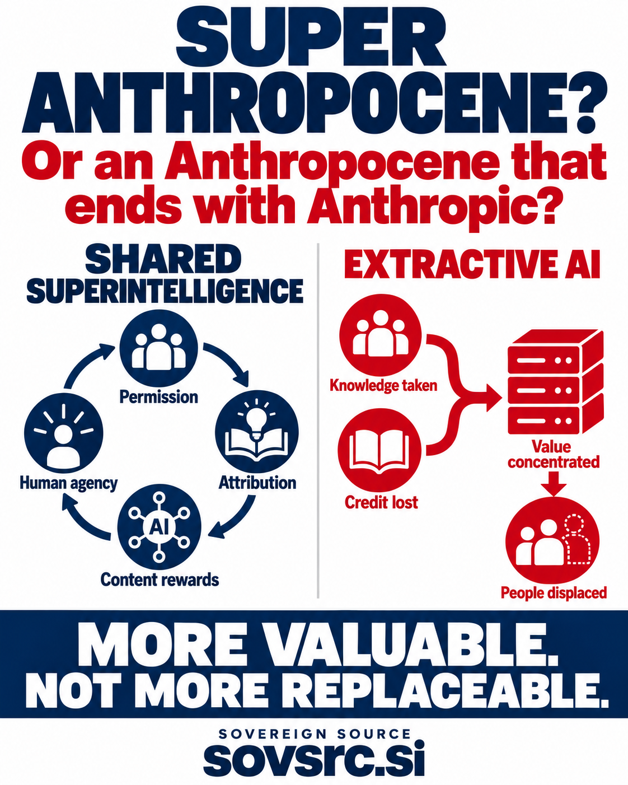

# The Super Anthropocene and the Value of Human Contribution

*An opinion article for Sovereign Source — 18 October 2026*

**A Super Anthropocene—or an Anthropocene that ends with Anthropic?**

The wordplay poses a serious question: will increasingly capable machines expand humanity's ability to create, discover and prosper, or will the people who supply their knowledge become easier to replace?

Anthropic is a memorable name in that question, but the choice applies across the AI industry. A company's name does not establish its intentions or economic effects. Anthropic's own Economic Index distinguishes uses that augment human work from uses that automate it. That distinction helps us examine how systems are used; it does not, on its own, tell us who receives the financial benefits. [Anthropic Economic Index](https://www.anthropic.com/news/the-anthropic-economic-index).

For Sovereign Source, a **Super Anthropocene** means an era in which more capable intelligence makes human contribution more valuable. It is a social and economic ambition: people retain agency, knowledge receives meaningful recognition, and the gains help sustain the people and communities who make further progress possible.

*Two possible economic relationships between AI developers and the people contributing knowledge.*

## Capability does not decide who benefits

Superintelligence would still be artificial intelligence. Greater capability does not automatically produce fairer outcomes, and existing AI can already help people cooperate. The contrast between shared superintelligence and extractive AI describes a choice about incentives, ownership and governance.

An AI system can help a researcher explore an unfamiliar field, give a small business access to useful expertise or reduce repetitive work. Those benefits matter. Automation can also displace paid work or shift bargaining power toward whoever controls the service. A society can become more productive while particular workers and creators become worse off.

That is why “win-win” should describe an outcome to work toward and test, rather than a promise attached to a powerful model. We should ask whether users gain useful services, contributors retain meaningful choices, workers share in improvements and operators can sustain the business. Lower production costs are only one part of that assessment.

## Human knowledge is a continuing activity

The extractive temptation is to treat human knowledge as an inventory: collect what already exists, transform it into a product and minimize what must be returned to its sources. The product may become impressive while its relationship with the people behind it becomes weaker.

But knowledge keeps changing. Scientists test claims. Engineers document failures. Teachers find better explanations. Communities preserve experiences that would otherwise disappear. A useful archive depends on the work that created it, and future usefulness can depend on people continuing to revise, challenge and extend it.

“Strip-mining human history” captures the danger of treating that living process as a resource to exhaust. It is a criticism of an economic incentive, not a claim that every AI use harms its contributors. The practical alternative is to build relationships that give people a reason and the means to keep contributing.

## Content rewards can support the next contribution

Content rewards offer one way to connect AI revenue with the production and maintenance of knowledge. A contributor could receive an agreed licence payment, compensation for commissioned expertise, a fee for maintaining a collection or a share of revenue from defined uses. Each arrangement should say what earns the reward, who owes it and how the calculation can be reviewed.

Consider a scientist who develops a useful mathematical method. An AI service could license an explanation, commission worked examples and pay for corrections or evaluation. The scientist receives resources to continue the research. Users receive a better-supported tool. The operator gains an authorized, maintained source of specialist knowledge.

Later researchers should receive recognition for their own discoveries while acknowledging relevant earlier work. Where participants have agreed to reward documented downstream uses, those relationships can also support continuing payments. The aim is to preserve an intelligible connection between contribution and benefit without pretending that every new idea has a single owner.

There are limits to what can be measured. A citation does not prove how much a document caused a model's answer. Similarity does not establish ownership. Training participation, source use, scholarly influence and a contractual right to payment are different things. Credible rewards should begin with defined contributions and uses that the parties can actually verify.

## Recognition must leave room for discovery

Sovereign Source's proposed **Super Intellectual Property** concept includes recognition of ideas, contributions and influences alongside formal intellectual property. It is a project concept, not a new category of statutory ownership or a claim that every fact should carry a toll.

Permission, attribution and compensation answer different questions. A work may require credit under its licence without requiring payment. A contributor may voluntarily offer a paid service around public knowledge. Someone may deserve scholarly acknowledgment without owning every later application of an idea.

A healthy system must preserve those distinctions. Public-domain knowledge, open licences and independent discovery should remain available on their own terms. Voluntary contributor agreements can create new opportunities without turning acknowledgment into a universal obligation to pay.

Voluntary syndicates could help contributors negotiate and administer those agreements together. Researchers, specialist publishers and communities could share the practical work while retaining individual recognition. Transparent accounts, member choice and fair dispute processes would determine whether a syndicate serves its members well.

## Two ways to organize the AI economy

| Question | An economy organized around extraction | An economy organized around shared gains |
| --- | --- | --- |
| How does knowledge enter the service? | Sources are treated chiefly as material to acquire at minimum cost. | Contributors have defined choices and agreed terms for participation. |
| What happens to recognition? | The source can disappear from the commercial relationship. | Attribution follows evidence and respects applicable disclosure limits. |
| Where does revenue flow? | Returns concentrate with the operator. | Agreements can direct benefits to contributors alongside returns to the operator. |
| What happens when knowledge changes? | Updates depend on whatever material becomes available. | Contributors can be compensated for corrections, maintenance and new work. |
| How are people affected by automation? | Replacement savings dominate the decision. | Better tools, accessible services and benefits for affected people also shape success. |

These are contrasting design choices, not descriptions of every company or predictions that one approach is inevitable. A real business should be assessed through its agreements, conduct and outcomes.

## Paying contributors is a business hypothesis worth testing

Contributor payments are a cost. They can also be an investment in useful supply. Direct relationships may produce fresher material, clearer permissions and faster corrections. They may reduce some preparation and sourcing work, strengthen trust and give participants reasons to recommend the service.

None of those gains is automatic. Rewards can be expensive to administer, attract low-quality submissions or generate disputes. The business case depends on whether the improvement in useful knowledge and customer value justifies the total cost. Goodwill helps only when it accompanies a service people want and economics that can support continued participation.

The strongest argument for content rewards is therefore practical as well as ethical: an AI business should have reason to invest in the human knowledge it expects to use tomorrow.

## A broader standard of progress

Content rewards cannot address every consequence of AI. People affected by automation may never have contributed a training document. Workers need a voice in transitions; users need affordable access; communities need ways to challenge harmful outcomes. An ambition named after humanity's planetary influence should also account for environmental costs, rather than measure progress only through computational capability.

Here, “Super Anthropocene” is a metaphor for those responsibilities, not a claim about a formally recognized geological epoch. The scientific use of Anthropocene and its status within the geological timescale are separate questions. [International Commission on Stratigraphy's Anthropocene overview](https://quaternary.stratigraphy.org/working-groups/anthropocene).

Sovereign Source is a research initiative exploring permission, attribution and agreed contributor rewards. An operating rewards platform remains an ambition. Its public proposition is that increasingly capable intelligence should help sustain the people who make knowledge possible.

The future should help fund the next discovery, support the next creator and give communities a meaningful stake in the services built from their knowledge.

**More valuable. Not more replaceable.**

*Explore [Sovereign Source](https://sovsrc.ai), its [manifesto](https://sovsrc.ai/manifesto.html), and the [Sovereign Source LLM initiative](https://sovsrc.ai/llm/).*
