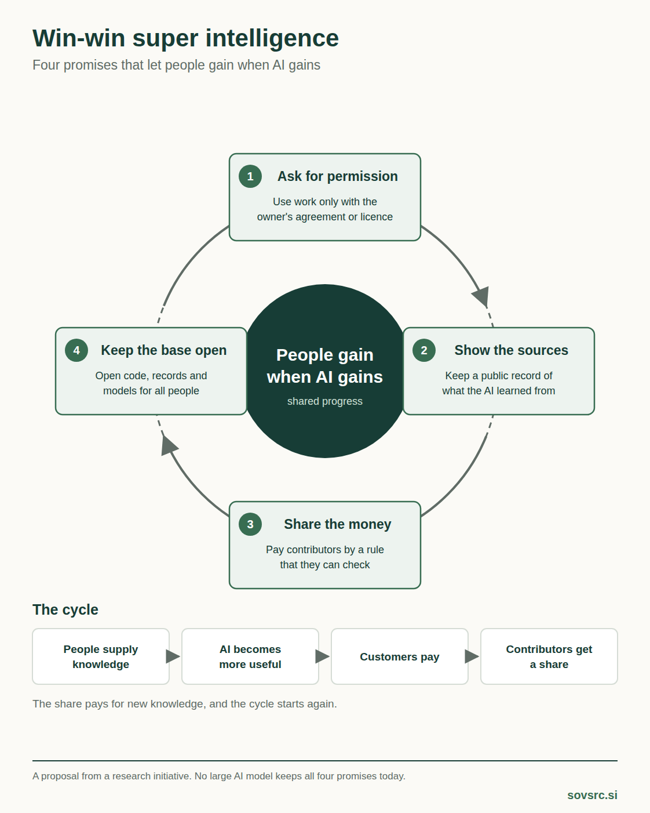

# Win-Win Super Intelligence: A Plain Guide

*A guide for all readers from Sovereign Source — 25 November 2026*

**AI learns from the work of people. A win-win AI gives something back to those people.** This guide explains that idea in plain words. It also links to each article in our library, so you can read more about each part.

<figure class="article-figure" style="max-width: none; width: 100%; margin: 2.5rem 0 3rem;">
  
  <figcaption>The four promises, and the circle that they make. <a href="../assets/infographics/win-win-super-intelligence-four-promises.png">View the full-size image</a>.</figcaption>
</figure>

## The short version

An AI system learns from books, articles, code, forums and other work that people made. Today, most of those people do not know that their work was used. Most of them get no credit and no money.

We think a better arrangement is possible. In that arrangement, the AI company asks first, shows its sources, and shares the income. The people who supply the knowledge then gain when the AI gains. That is what we mean by "win-win".

"Super intelligence" means AI that becomes much more capable than it is today. The more capable it becomes, the more important this question is. [Superintelligence Should Be a Win for Humans and Machines](SUPERINTELLIGENCE_SHARED_PROSPERITY_ARTICLE.md) explains the idea in full.

## A simple comparison

Think of a public library and a copy shop.

A library buys its books. Authors get paid when the library buys a book, and readers can see which book an idea came from. A copy shop that copies books without permission also gives readers the content. But the author gets nothing, and the reader cannot always tell where the text came from.

Much of AI today works more like the copy shop. We want AI to work more like the library. Our article [The Super Anthropocene and the Value of Human Contribution](SUPER_ANTHROPOCENE_ARTICLE.md) shows these two possible futures side by side.

## What "extractive" means

We use the word "extractive" for AI that takes knowledge and gives nothing back. Three things make an AI extractive:

1. It uses work without permission.
2. It hides where its knowledge came from.
3. It keeps all the income, and it can compete with the people whose work trained it.

An open licence does not fix this. A model can be free to download and still be extractive. [AI Models: From Extractive to Shared](AI_MODELS_EXTRACTIVE_TO_SHARED_ARTICLE.md) puts 17 well-known models on one chart. No released model is in the top, "shared" row today.

## The four promises of a win-win AI

### 1. Ask for permission

The AI company uses work only when the owner agrees, or when the licence permits it. Public domain text, such as Shakespeare, needs no permission.

Some open models already do this. They train only on public domain and openly licensed text. The [matrix article](AI_MODELS_EXTRACTIVE_TO_SHARED_ARTICLE.md) lists them.

### 2. Show the sources

The AI company keeps a public record of what it trained on. Any person can then check if their work is in it, and ask to remove it.

Our [CommonLLM proposal](COMMONLLM_COMMON_CRAWL_OPEN_SOURCE_LLM_ARTICLE.md) describes a model built from public web pages, with a record for each page. Tools such as OpenWALDO already make records that link the data, the training and the model. See [Building a Sovereign Source Model with OpenWALDO and LLM Content Rewards](OPENWALDO_LLM_CONTENT_REWARDS_ARTICLE.md).

### 3. Share the money

When the AI earns money, a part goes to the people whose work made it useful. We call this "content rewards".

The amount follows a clear rule that contributors can check. Our small public demonstration shows one such rule with 16 speeches from Macbeth. See [Macbeth and Content Rewards: The Source Code](MACBETH_CONTENT_REWARDS_SOURCE_CODE_ARTICLE.md).

### 4. Keep the base open

The code, the records and, where possible, the model are open for all people to examine and use. A small company or a school can then build on the same base as a large company.

[Nemotron 3 Ultra, OpenWALDO, Sovereign Source SI and CommonLLM Side by Side](NEMOTRON_OPENWALDO_SOVEREIGN_SOURCE_COMMONLLM_COMPARISON_ARTICLE.md) shows how four open projects can fit together as one stack.

## What it looks like for each person

| Person | Today | In a win-win arrangement |
| --- | --- | --- |
| A writer, teacher or researcher | Their work trains AI with no notice, no credit and no pay | They decide if their work is used, see where it is used, and get a share |
| A small business | It rents AI from a few large companies and cannot see inside it | It uses an open model with known sources, and it can change suppliers |
| An AI company | It faces lawsuits and has to find data again and again | It has partners who keep their knowledge current and accurate |
| The public | It cannot tell where an answer came from | It can check the source of an answer |

## Why AI companies also win

Payment is a cost. But it also brings benefits that a company can measure:

- **Better data.** A person who gets paid has a reason to keep their work correct and current.
- **Less risk.** Agreed use is safer than use that a court can stop.
- **More trust.** Customers and regulators can check the sources.

These articles explain the business case:

- [The Business Case for AI Content Rewards](CONTENT_REWARDS_BUSINESS_CASE_250_WORDS.md) — the short version, in 250 words
- [Why Paying AI Contributors Can Lower Costs and Grow Demand](CONTENT_REWARDS_AI_SUSTAINABILITY_ARTICLE.md)
- [Content Rewards Can Open the AI Investment Economy](AI_CIRCULAR_ECONOMY_CONTENT_REWARDS_ARTICLE.md)

We also wrote open proposals to three AI companies:

- [Why Content Rewards Could Strengthen Anthropic and Claude](ANTHROPIC_CLAUDE_CONTENT_REWARDS_ARTICLE.md)
- [Why Content Rewards Could Strengthen OpenAI and ChatGPT](OPENAI_CHATGPT_CONTENT_REWARDS_ARTICLE.md)
- [A Proposal for Grok and xAI to Reward Human Knowledge](GROK_XAI_CONTENT_AWARDS_PROPOSAL_ARTICLE.md)

## A fair test of the idea

A good idea must survive hard questions. Who pays? Is the money real? Do the numbers work? Some critics of the AI industry ask these questions well.

[What Ed Zitron's AI Criticism Means for Content Rewards](ED_ZITRON_CONTENT_REWARDS_ARTICLE.md) takes those questions seriously. Its answer is to count each cost and to prove value to customers, not only to draw a circle on a slide.

## How it can be built

These articles are for readers who want the technical detail:

- [CommonLLM: Common Crawl as an LLM for Open Source AI and SI](COMMONLLM_COMMON_CRAWL_OPEN_SOURCE_LLM_ARTICLE.md) — an open model from public web pages, with a record for each page
- [Building a Competing AI Model with Nemotron 3 Ultra](NEMOTRON_COMPETING_MODEL_ARTICLE.md) — what a large open model from NVIDIA permits
- [Building a Sovereign Source Model with OpenWALDO and LLM Content Rewards](OPENWALDO_LLM_CONTENT_REWARDS_ARTICLE.md) — records for each step of training
- [Google Harness2 and Sovereign AI Development](HARNESS2_SOVEREIGN_AI_ARTICLE.md) — improve an AI agent without a new model
- [Using Claude and OpenAI to Build AI Software](CLAUDE_OPENAI_SOFTWARE_DEVELOPMENT_TERMS_ARTICLE.md) — the contract terms of AI coding tools
- [Macbeth and Content Rewards: The Source Code](MACBETH_CONTENT_REWARDS_SOURCE_CODE_ARTICLE.md) — a small program that calculates rewards

## Where we are today

We want to be honest about the state of this work.

- Sovereign Source is a research initiative. It is not a company that pays contributors today.
- Our rewards program is a small demonstration. It calculates numbers. It makes no payment.
- CommonLLM is a proposal. No CommonLLM model exists yet.
- No large AI model is fully win-win today. Some models use only permitted data. Some companies pay some publishers. None does all four promises.

The direction is clear, and some parts already exist. The task is to join them.

## Questions people ask

**Is this against AI?** No. We want AI to become more capable. We want the people behind it to share in that progress.

**Will I get paid if my blog trained an AI?** Not today, from most companies. A win-win arrangement would make that possible by agreement.

**Does this make AI more expensive?** It adds a cost. It can also lower other costs, such as legal risk and the work to find good data. The [business case](CONTENT_REWARDS_BUSINESS_CASE_250_WORDS.md) explains this.

**Who decides the rules?** The contributors and the company agree on them. The rules must be clear enough that a contributor can check a payment.

**Can I see the code?** Yes. The [rewards code](https://github.com/niccolox/sovsrc.si.core) is public, and a [live demonstration](https://hello.sovsrc.si/ui) runs on the web.

## All articles in our library

| Topic | Article |
| --- | --- |
| Principles | [Sovereign Source: Principles and Purpose](PUBLIC_OVERVIEW.md) |
| The vision | [Superintelligence Should Be a Win for Humans and Machines](SUPERINTELLIGENCE_SHARED_PROSPERITY_ARTICLE.md) |
| The vision | [The Super Anthropocene and the Value of Human Contribution](SUPER_ANTHROPOCENE_ARTICLE.md) |
| The models today | [AI Models: From Extractive to Shared](AI_MODELS_EXTRACTIVE_TO_SHARED_ARTICLE.md) |
| Business case | [The Business Case for AI Content Rewards](CONTENT_REWARDS_BUSINESS_CASE_250_WORDS.md) |
| Business case | [Why Paying AI Contributors Can Lower Costs and Grow Demand](CONTENT_REWARDS_AI_SUSTAINABILITY_ARTICLE.md) |
| Business case | [Content Rewards Can Open the AI Investment Economy](AI_CIRCULAR_ECONOMY_CONTENT_REWARDS_ARTICLE.md) |
| Proposals to companies | [Why Content Rewards Could Strengthen Anthropic and Claude](ANTHROPIC_CLAUDE_CONTENT_REWARDS_ARTICLE.md) |
| Proposals to companies | [Why Content Rewards Could Strengthen OpenAI and ChatGPT](OPENAI_CHATGPT_CONTENT_REWARDS_ARTICLE.md) |
| Proposals to companies | [A Proposal for Grok and xAI to Reward Human Knowledge](GROK_XAI_CONTENT_AWARDS_PROPOSAL_ARTICLE.md) |
| A critical view | [What Ed Zitron's AI Criticism Means for Content Rewards](ED_ZITRON_CONTENT_REWARDS_ARTICLE.md) |
| Open models | [CommonLLM: Common Crawl as an LLM for Open Source AI and SI](COMMONLLM_COMMON_CRAWL_OPEN_SOURCE_LLM_ARTICLE.md) |
| Open models | [Building a Competing AI Model with Nemotron 3 Ultra](NEMOTRON_COMPETING_MODEL_ARTICLE.md) |
| Open models | [Nemotron 3 Ultra, OpenWALDO, Sovereign Source SI and CommonLLM Side by Side](NEMOTRON_OPENWALDO_SOVEREIGN_SOURCE_COMMONLLM_COMPARISON_ARTICLE.md) |
| How to build it | [Building a Sovereign Source Model with OpenWALDO and LLM Content Rewards](OPENWALDO_LLM_CONTENT_REWARDS_ARTICLE.md) |
| How to build it | [Google Harness2 and Sovereign AI Development](HARNESS2_SOVEREIGN_AI_ARTICLE.md) |
| How to build it | [Using Claude and OpenAI to Build AI Software](CLAUDE_OPENAI_SOFTWARE_DEVELOPMENT_TERMS_ARTICLE.md) |
| The code | [Macbeth and Content Rewards: The Source Code](MACBETH_CONTENT_REWARDS_SOURCE_CODE_ARTICLE.md) |

*Sovereign Source is a research initiative. These articles describe proposals, not an operating payment service.*
